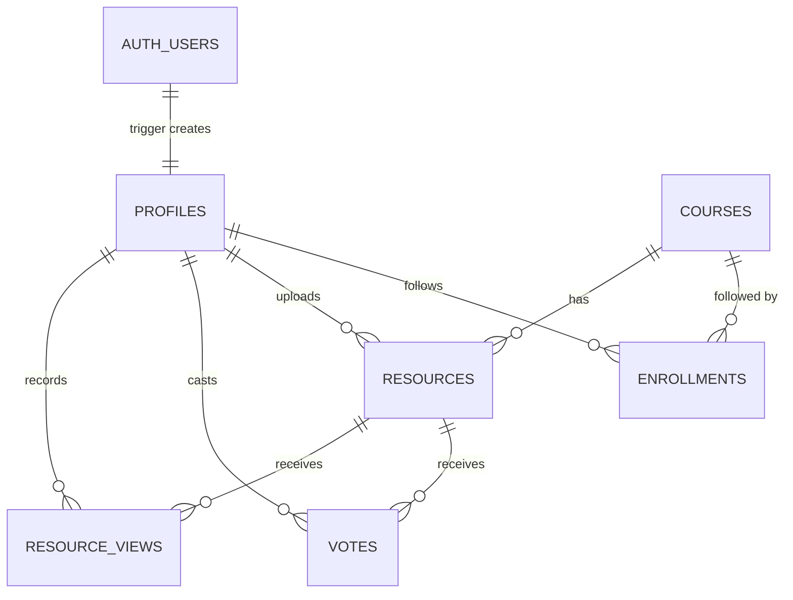

# Database: how it works

Our database is Supabase Postgres. All of it is defined by the SQL files in this folder, so the files are the source of truth. If it's not in a file here, it shouldn't be in the database.

| File | What it does |
|---|---|
| `01_schema.sql` | Tables, constraints, the `resources_with_stats` view, sign-up triggers |
| `02_policies.sql` | Row Level Security: who can read and change what |
| `03_seed.sql` | Starter McGill courses for the demo |
| `04_remove_mcgill_trigger.sql` | Removes the McGill trigger from `01` (the auth hook replaces it) |
| `checkifmcgill.sql` | The McGill-only sign-up check, used as a Supabase auth hook |

---

## Setting it up

1. Supabase Dashboard → **SQL Editor** → **New query**
2. Paste `01_schema.sql` and run it.
3. Paste `02_policies.sql` and run it.
4. Paste `03_seed.sql` and run it.
5. Paste `04_remove_mcgill_trigger.sql` and run it.
6. Paste `checkifmcgill.sql` and run it.
7. Dashboard → **Authentication → Hooks** → add a **Before User Created** hook → type **Postgres** → schema `public` → function `hook_mcgill_email_only`. **This step is manual. Without it, anyone can sign up.**

Order matters: policies need the tables, and the seed needs `courses`.

`01` and `02` can only run **once** on a fresh database. Running them again errors with "already exists". `03`, `04` and `checkifmcgill.sql` are safe to re-run.

---

## How the tables connect



Every foreign key uses `on delete cascade`. Deleting a user removes their profile, resources, votes, views and enrollments. Deleting a resource removes its votes and views.

---

## Tables

### `profiles`
One row per user. **You never insert into this yourself.** A trigger creates it when someone signs up.

| Column | Type | Notes |
|---|---|---|
| `id` | uuid | Same as `auth.users.id` |
| `display_name` | text | 1–50 chars |
| `created_at` | timestamptz | |

To set a display name at sign-up, pass it as metadata:
```ts
await supabase.auth.signUp({
  email, password,
  options: { data: { display_name: "Alice" } },
});
```
If you don't pass one, it defaults to the part of the email before the `@`.

### `courses`
Read-only for users. We add courses through `03_seed.sql`.

| Column | Type | Notes |
|---|---|---|
| `id` | bigint | Auto |
| `code` | text | Unique. Format `ABCD 123`, optional 1–2 trailing chars (`MATH 262D1`) |
| `title` | text | |
| `subject` | text | Auto-filled from the code (`COMP`, `MATH`) |

### `enrollments`
"User follows course." Powers the **My courses** toggle.

| Column | Type | Notes |
|---|---|---|
| `user_id` | uuid | |
| `course_id` | bigint | |

The primary key is `(user_id, course_id)`, so following twice is impossible. To unfollow, delete the row.

### `resources`
A shared link for a course.

| Column | Type | Notes |
|---|---|---|
| `id` | bigint | Auto |
| `course_id` | bigint | Must be a real course |
| `uploader_id` | uuid | **Auto-set to the logged-in user.** Don't send it |
| `title` | text | 1–120 chars |
| `description` | text | ≤ 1000 chars, defaults to `''` |
| `url` | text | Must start with `http://` or `https://`, ≤ 2048 chars |
| `link_type` | text | One of `drive_file`, `drive_folder`, `google_doc`, `google_slides`, `google_sheet`, `other` |
| `preview_title` | text | From Microlink, nullable |
| `preview_image` | text | From Microlink, nullable |
| `created_at` | timestamptz | |

The same URL can't be posted twice **to the same course**. The insert fails with error code `23505`, so show "This link was already shared here."

### `votes`
Like / dislike.

| Column | Type | Notes |
|---|---|---|
| `user_id` | uuid | |
| `resource_id` | bigint | |
| `value` | smallint | `1` = like, `-1` = dislike |

One vote per user per resource. Use **upsert** to switch a vote, and **delete** to remove it. There's no `0` value.

### `resource_views`
Each user counts once per resource.

| Column | Type | Notes |
|---|---|---|
| `user_id` | uuid | |
| `resource_id` | bigint | |
| `viewed_at` | timestamptz | |

Record a view with an upsert that ignores duplicates (see below). Opening the same resource again doesn't increase the count.

### `resources_with_stats` (a view, not a table)
**Read from this when showing resources.** It's `resources` plus:

| Extra column | Meaning |
|---|---|
| `course_code` | e.g. `COMP 307` |
| `uploader_name` | Uploader's `display_name` |
| `likes` | Count of +1 votes |
| `dislikes` | Count of −1 votes |
| `view_count` | Count of unique viewers |

You can't insert into it. Write to `resources`, and read from here.

---

## Security (Row Level Security)

RLS is turned on for every table. The rules are:

| | Logged out | Logged in |
|---|---|---|
| Read anything | ❌ nothing | ✅ everything |
| Create / change / delete | ❌ | ✅ **only your own rows** |
| Courses | ❌ | ✅ read only |
| Profiles | ❌ | ✅ read all, update your own, no insert (trigger does it) |

"Your own" means the row's `user_id` / `uploader_id` matches the logged-in user. The **database** enforces this, not our code. If someone calls the API to delete another person's resource, nothing happens (0 rows affected, no error), so check the result if you need to show a message.

**McGill-only sign-up:** the `hook_mcgill_email_only` auth hook (`checkifmcgill.sql`) rejects any email that doesn't end in `@mail.mcgill.ca` or `@mcgill.ca`. It runs on Supabase's server, so going around the form doesn't get past it. `supabase.auth.signUp()` returns the error *"Please sign up with your McGill email (@mail.mcgill.ca or @mcgill.ca)."*, which the sign-up form can show as-is.

---

## Using it from Next.js

Use the Supabase client from `lib/supabase/server.ts` (server components / route handlers) or `lib/supabase/client.ts` (client components).

```ts
// Courses, with search
const { data } = await supabase
  .from("courses")
  .select("*")
  .or(`code.ilike.%${q}%,title.ilike.%${q}%`)
  .order("code");

// My courses
const { data } = await supabase
  .from("enrollments")
  .select("course_id, courses(*)")
  .eq("user_id", user.id);

// Follow / unfollow
await supabase.from("enrollments").insert({ user_id: user.id, course_id });
await supabase.from("enrollments").delete().match({ user_id: user.id, course_id });

// Course board, sorted
const { data } = await supabase
  .from("resources_with_stats")
  .select("*")
  .eq("course_code", "COMP 307")
  .order("created_at", { ascending: false }); // or "likes" / "view_count"

// One resource
const { data } = await supabase
  .from("resources_with_stats")
  .select("*")
  .eq("id", id)
  .single();

// Share a resource (uploader_id is set automatically)
const { error } = await supabase.from("resources").insert({
  course_id, title, description, url, link_type,
  preview_title, preview_image,
});
if (error?.code === "23505") { /* already shared in this course */ }

// Vote: like = 1, dislike = -1
await supabase.from("votes").upsert({ user_id: user.id, resource_id, value: 1 });
// Remove vote
await supabase.from("votes").delete().match({ user_id: user.id, resource_id });

// Record a view (ignored if already viewed)
await supabase
  .from("resource_views")
  .upsert({ user_id: user.id, resource_id }, { ignoreDuplicates: true });
```

---

## Changing the schema

1. **Never use the Table Editor.** Only use the SQL Editor.
2. Don't edit an old `create table` that's already been run. Add a new numbered file, for example `04_add_tags.sql`, with `alter table ...`.
3. Run it in the SQL Editor, commit the file, and tell the team in chat.
4. If you add a table, **enable RLS and add policies in the same file**, or the table will be unreadable.

## Starting over (dev only)

To wipe everything and re-run the setup steps from 2 to 5, run this in the SQL Editor. The auth hook isn't touched, so steps 6 and 7 don't need repeating. **It deletes all data.**

```sql
drop view  if exists public.resources_with_stats;
drop table if exists public.resource_views, public.votes, public.resources,
                     public.enrollments, public.courses, public.profiles cascade;
drop trigger  if exists enforce_mcgill_email  on auth.users;
drop trigger  if exists on_auth_user_created  on auth.users;
drop function if exists public.enforce_mcgill_email();
drop function if exists public.handle_new_user();
```
